# MuseAi-Side-Chats

A dark, animated static guide that helps Muse users organize side chats, understand what crosses between chats, and stop losing useful conversations.

**Pin what matters. Never lose a chat.**

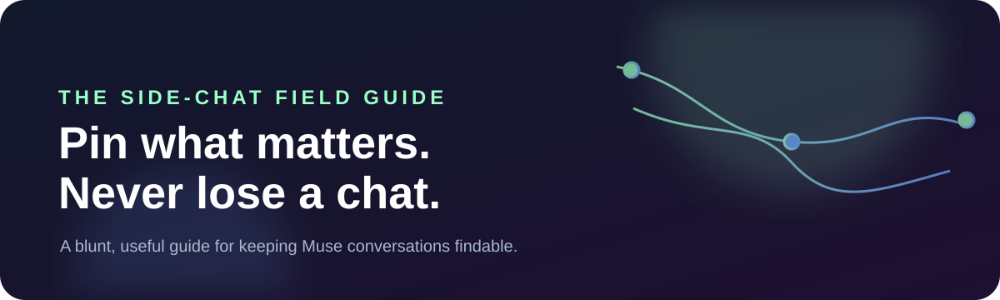

> This repository is a no-build static site. It can be opened locally or deployed directly to GitHub Pages and Cloudflare Pages.

## Why this exists

Side chats are easy to create and easy to lose. The main chat does not automatically watch every side-chat transcript, and the current workflow does not give users a reliable folder system. That leaves people asking the same frustrating question: “Where did that useful conversation go?”

This project turns the answer into a small, direct system:

- use one side chat per topic or project;
- pin the conversations that matter;
- keep one pinned **Summarized Side Chats** archive;
- understand the difference between shared memory and a transcript that was never carried across.

The site is intentionally plain about the mechanics. It is not trying to replace the chat product. It is a memorable field guide wrapped in a fast, dark, animated landing page.

## See it work

A live demo URL has not been configured in this repository yet. The site is fully static and ready for a GitHub Pages or Cloudflare Pages deployment.

### Real working demo

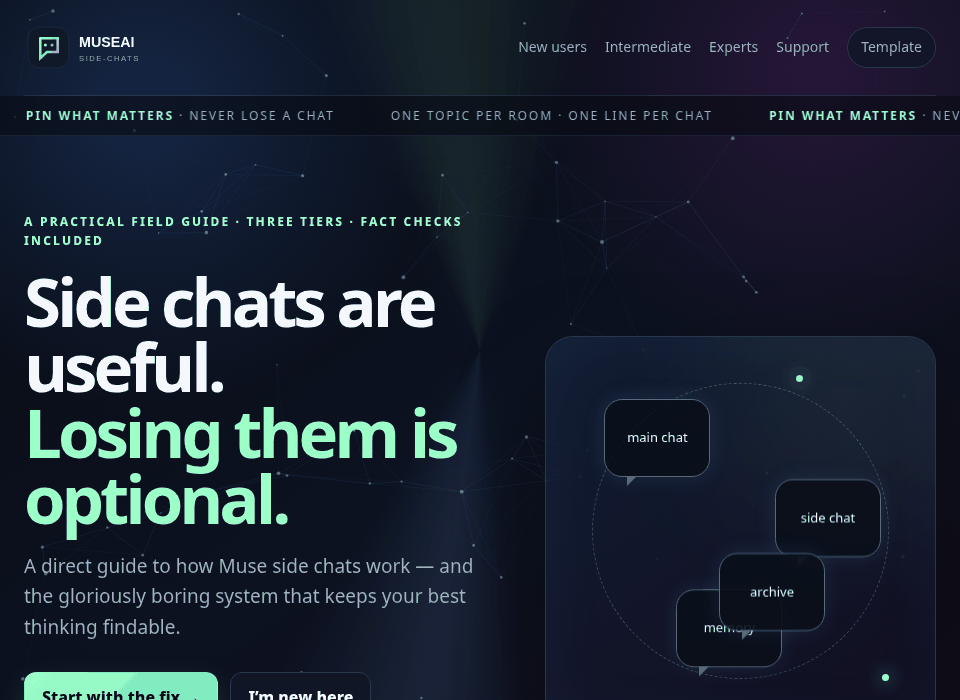

The GIF above is rendered from the actual `index.html` running locally. It is not a product mockup.

### Visual system

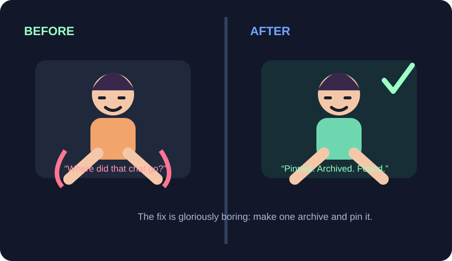

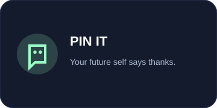 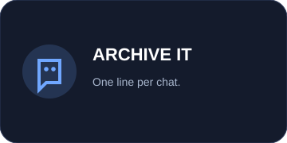 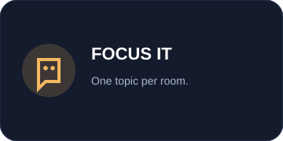 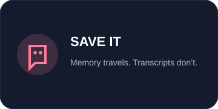

## Quick start

There is no package install and no build step.

```bash
# clone or download the repository
cd muse-ai-side-chats-site

# run the real site locally
python3 -m http.server 8080
```

Open [http://localhost:8080](http://localhost:8080) and start at [`index.html`](index.html).

For a quick smoke test of local HTML/CSS/image references:

```bash
python3 scripts/check-site.py
```

## Main routes

| Route | What it does |
|---|---|
| [`index.html`](index.html) | Animated landing page and guide overview |
| [`new-users.html`](new-users.html) | One-topic-per-chat introduction |
| [`intermediate.html`](intermediate.html) | The pinned archive workflow |
| [`experts.html`](experts.html) | Shared memory, deliberate carrying, and transcript boundaries |
| [`templates.html`](templates.html) | Copy/paste archive template |
| [`support.html`](support.html) | Age-gated subscription, donation, and centered Discord tabs |
| [`join.html`](join.html) | Supabase-backed email-list sign-up, sign-in, reset, and logout flow |
| [`discord.html`](discord.html) | Discord server directory with an 18+ email-request flow |
| [`private-communities.html`](private-communities.html) | 18+ and country-eligibility gate for the private Matrix room |

## Screenshots

### Homepage

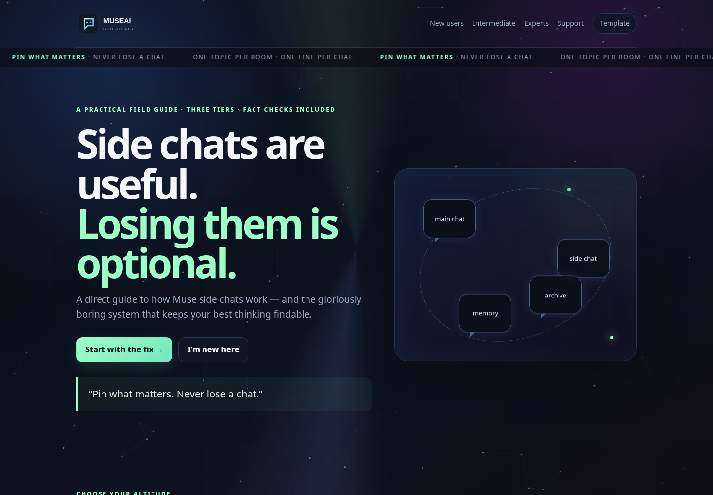

### Age-gated support page

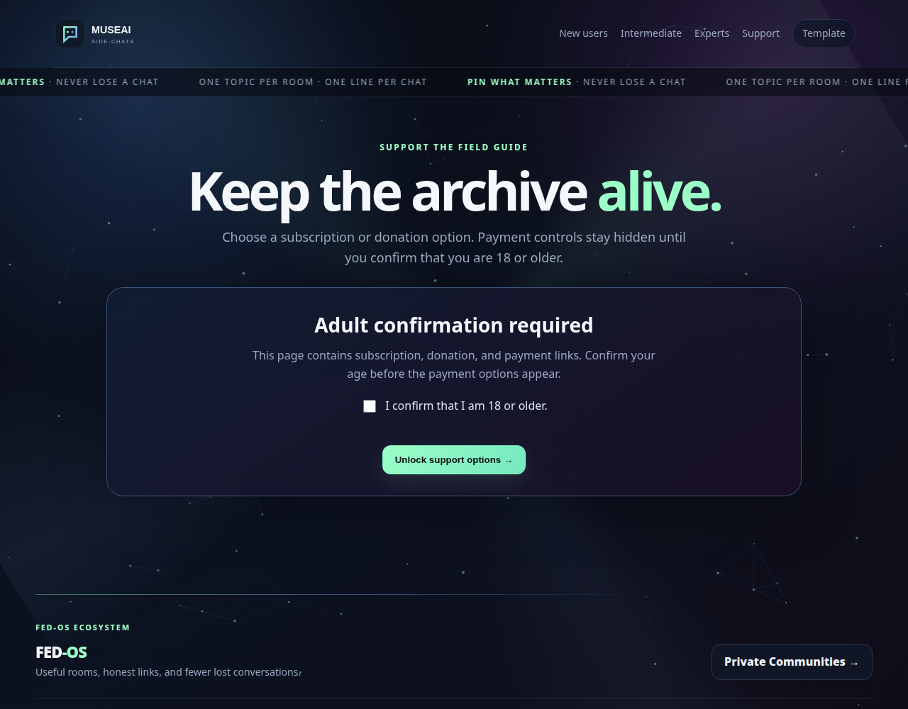

### Discord directory

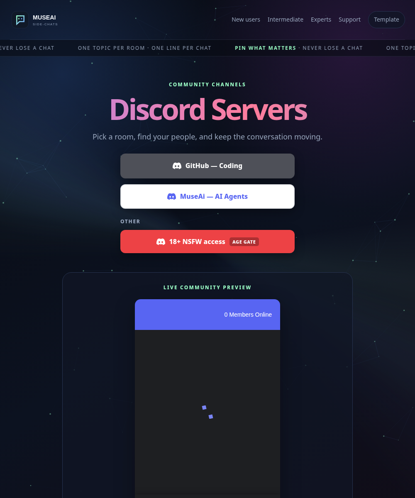

### Private communities gate

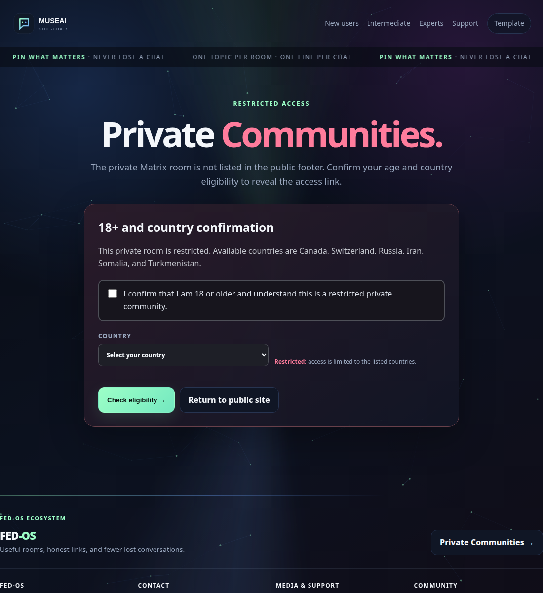

## Content structure

The guide is available both as navigable HTML pages and as source Markdown files:

```text
.
├── index.html
├── new-users.html
├── intermediate.html
├── experts.html
├── templates.html
├── support.html
├── discord.html
├── private-communities.html
├── assets/
│   ├── demo/demo.gif
│   ├── screenshots/
│   ├── favicon.svg
│   ├── logo.svg
│   ├── hero-banner.svg
│   └── promotional badges and illustrations
├── new-users/*.md
├── intermediate/*.md
├── experts/*.md
└── templates/*.md
```

The shared visual layer lives in [`styles.css`](styles.css), while the animated particle field and copy interaction live in [`app.js`](app.js).

## Deployment

### GitHub Pages

1. Push the repository to GitHub.
2. In **Settings → Pages**, choose **Deploy from a branch**.
3. Select the branch and the repository root as the folder.
4. Keep `.nojekyll` at the root so GitHub Pages serves the static files as written.

### Cloudflare Pages

1. Create a Pages project from the repository.
2. Use the repository root as the project directory.
3. Leave the build command empty.
4. Leave the output directory as the repository root.

The repository includes `_headers`, `_redirects`, `robots.txt`, and `sitemap.xml` for static hosting. Replace the placeholder `example.com` sitemap host with the real deployed domain before launch.

## Accessibility and safety notes

The HTML includes descriptive image alt text, keyboard-friendly buttons, responsive layouts, and reduced-motion fallbacks for the Discord directory. Subscription, donation, adult-community, and private-community links are intentionally placed behind visible confirmation flows. The age and country checks are front-end gates, not identity or legal-age verification.

## License

No license file is currently present. Treat the repository as **all rights reserved** until a license is added.
